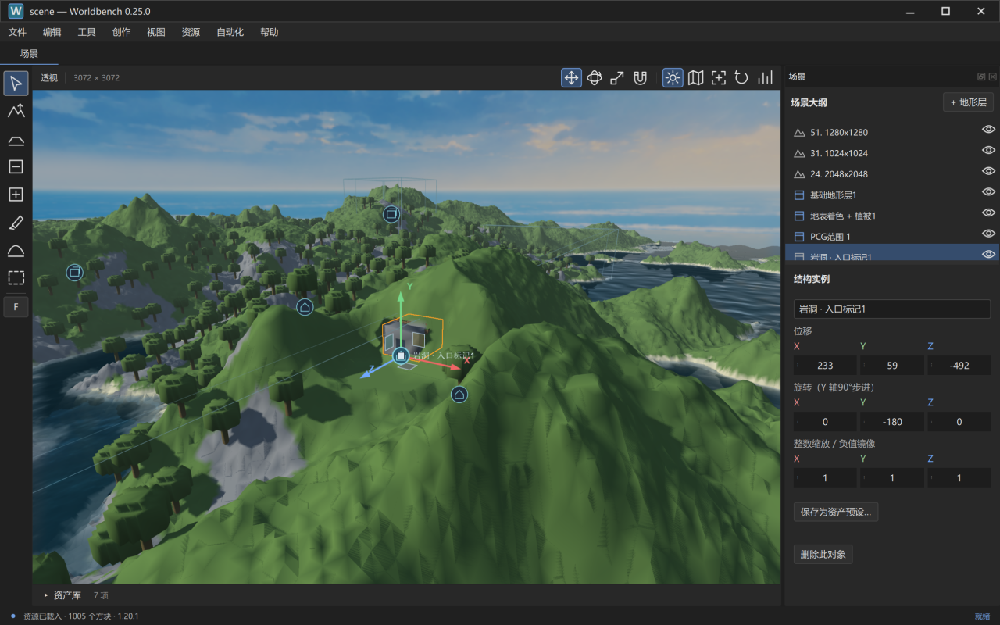

# Worldbench 0.25.0 验收单 · BK

[启动编辑器](E:/AppProject/Worldbench/dist/Worldbench-0.25.0/Worldbench.exe) · [构建版本与校验值](E:/AppProject/Worldbench/dist/Worldbench-0.25.0/build-info.json) · [开发文档](DEVELOPMENT.md)

打开 3072×3072 测试工程的副本，加载平时使用的 1.20.1 JAR。按 **0** 切到导航模式。测试 BK01–BK05 可以用已有的岩洞、树和森林范围。工程原件保存在下载目录，本轮使用的副本和原件 SHA256 相同。

| 编号 | 操作 | 预期效果 |
| --- | --- | --- |
| BK01 自动简化 | 放置工程内岩洞，再导入一份轮廓明显不同的建筑或结构。分别围绕两者观察，再沿原方向逐渐拉远。 | 近处可辨实际方块，拉远后保留各自的大轮廓并逐步减少细节。每份结构按自身的方块和当前资源模型生成网格。简单模型可跳过没有简化收益的档位。纯挖空模式只产生切口。 |
| BK02 移动与等待 | 分别平移一棵悬空树、一个触及地面的岩洞和最大的森林范围。先拖住观察，再松手，用 Ctrl+Z 撤销。 | 拖动时位置和操纵器即时跟随。松手后岩洞在新位置掏空，原位置恢复；森林按新覆盖区贴地。密集场景仍可能需要数秒。反馈卡顿时请说明发生在拖动中还是松手后。 |
| BK03 直接选择 | 在导航模式点树干、建筑墙面及岩洞实体壳；再分别点 PCG 图标、露出的外框边和内侧过渡边。让地形挡住一段框线，从同一方向点击。 | 本体点击选中对应实例，点击可见框线选中该范围，大纲、详情及操纵器同步。地形后被遮住的线不抢选。选中范围框与结构描边同为金橙色。 |
| BK04 取消选择 | 点选实例后按 Esc。重新选中，再点普通地面或天空。最后拖动操纵器途中按 Esc。 | 前两种操作清空实例选择和操纵器；拖动中的首次 Esc 取消变换，保留该实例供继续操作。 |
| BK05 范围旋转 | 选长宽不同的 PCG 范围，按 E 绕 Y 转 45°。用详情再试 X 或 Z，并检查过渡带，保存副本后重开。保存为范围预设，从库中拖入另一个位置。 | 三轴旋转弧可用，外框、过渡带与实际生效的区域一起旋转。倾斜时只有落在盒内的地表参与生成。重开、撤销及新放置预设都保留对应角度。世界坐标的散布候选在松手后重新筛选。 |
| BK06 两种图 | 在资产库分别新建 PCG 图和地表材质。前者指定树或岩石作为散布资产，后者指定可辨颜色的表层方块，各自拖入场景并保存范围预设。 | 前者只提供结构散布输出，后者只提供地表材料输出。库中有独立的图及对应类别的范围预设；可以独立控制两种效果的范围与可见性。 |
| BK07 旧混合图 | 打开旧工程内同时含地表和散布输出的图。截取或记住位置后点“拆分旧混合图”，分别隐藏两个范围，撤销。 | 初次打开保留原效果。拆分后出现一份地表材质图及匹配范围，两种效果可单独编辑；拆分瞬间地面和散布的位置与原图一致。整步拆分可撤销。接近工程求值上限时，拆出的两份范围会分别计入预算；超限会提示并保留原图。 |
| BK08 结构分类 | 在库中双击旧树、建筑和岩洞，再导入一份不带分类的结构。切换类别，观察标记和放置模式。 | 树归开放结构，有根部／放置枢轴。建筑与洞穴归封闭结构，有底座、入口、封口、内部种子与泄漏分析；原建筑保留仅放实体的行为。新结构用是否含叶片推断初始分类，可以手动改正。 |

## 工程实测

下面是工程副本中的岩洞实体壳。程序从它的实际方块自动生成六档网格，三角形数依次为 **2212、618、308、154、66、24**。保存和 Minecraft 导出使用原始方块与确认的室内空气。

本机使用真实 stdio MCP 测量从发出移动命令到可稳定截图的时间。复用数是前后快照中继续使用同一个原网格的对象数。松手收敛耗时与鼠标拖动帧率分别衡量。

| 操作 | 复用原网格 / 当前对象数 | 更新远景块 / 精确区块 | 至稳定画面 |
| --- | ---: | ---: | ---: |
| 岩洞平移 4 格、升高 5 格 | 1546 / 1547 | 4 / 0 | 1.54 秒 |
| 最大 PCG 范围平移 4 格 | 1542 / 1552 | 28 / 0 | 3.19 秒 |

[机器可读测量记录](test-reference/0.25.0/move-review.json)

## WorldPainter 相关进展

| 开发文档父子条目 | 这次可验收的变化 | 测试 |
| --- | --- | --- |
| WB-06.2–06.4 结构资产、WB-08.2–08.4 洞室与入口 | 开放与封闭结构分别编辑，已有结构与洞室标记兼容，岩洞壳体与普通结构一样自动分级。 | BK01、BK03、BK08 |
| WB-05.1–05.5 地表材质、WB-07.1–07.3 实例散布 | 地表材质和散布独立建图、旋转范围、保存预设及拆分已有混合图。 | BK05–BK07 |
| WB-12.3／12.4 近远网格与视口预览 | 移动复用结构网格，按实际受到影响的区域更新地形。 | BK01、BK02 |

视口直接选择、Esc 和选中颜色属于 Worldbench 的 3D 操作体验。沿边规则布置、分块增量 PCG，以及 8K／16K 复杂场景全流程性能验收仍在开发文档中跟踪。
