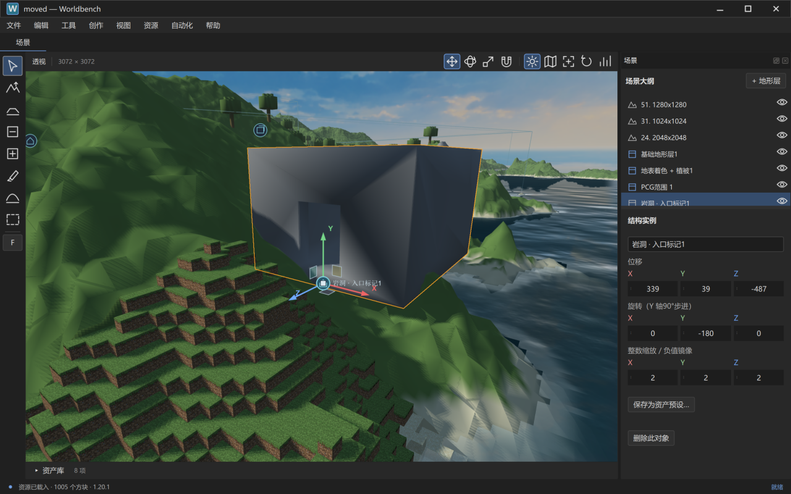

# Worldbench 0.26.0 验收单 · BL

[启动 Worldbench](E:/AppProject/Worldbench/dist/Worldbench-0.26.0/Worldbench.exe) · [开发文档](DEVELOPMENT.md) · [构建信息](E:/AppProject/Worldbench/dist/Worldbench-0.26.0/build-info.json)

打开 3K 测试工程副本并载入平时的 Minecraft 资源，按 **0** 切到导航，按 **W** 使用平移柄。

| 编号 | 操作 | 预期 |
| --- | --- | --- |
| BL01 独立建筑 | 将实体建筑放在森林外，横移几格、升高再放下，连续操作。在远景和靠近建筑时分别观察。 | 结构和控件跟随鼠标，松手可继续编辑。移动离地建筑时，地形与森林保持稳定；穿入地面时接触面的变化只出现在局部。 |
| BL02 原工程岩洞 | 选中原有「岩洞 · 入口标记」，水平移 4 格、升高 5 格，观察洞室和旧位置，再移回。 | 新位置内部挖空，原位置露回原地面。旧方块与岩壁重合时按工程覆盖顺序显示。连续移动时留意松手是否仍有停顿。 |
| BL03 PCG 碰撞 | 把手放结构从空处移到森林中一棵散布树的位置，再移开。另移动整片森林范围。 | 如果位移改变散布判定，会重新计算，树木按碰撞规则避让和恢复。整个森林范围仍按新位置重新贴地。 |
| BL04 历史和保存 | 在两个位置之间移动后撤销、重做，另存并重开，再用笔刷和视口拾取检查接触面。 | 位置、洞室、方块覆盖和保存前一致。 |
| BL05 边界 | 将结构拖到世界边界之外并松手，再回到合法区域移动。 | 越界操作回滚，后续合法移动正常。 |

### 性能记录

在同一台 i9-13900K / RTX 4080 工作站上，使用上一轮保留的工程副本和下载目录中较新的工程副本。建筑样本使用工程岩洞的同一份 538 个实体方块，切到普通刚性放置，关闭地基并放在森林外。岩洞样本保留入口、原位置和内部空气。每个视角分别执行 12 次往返，每次水平移 4 格并升高或降低 5 格。近处与远处的相机位置独立设置。另将建筑三个轴均放大两倍，以相同位移测试 4304 个实体方块的结构。

“生成”计量权威方块更新；“松手返回”还含网格和界面的同步工作；“上屏”计至 Qt 报告包含当前工程、当前网格修订的帧交换。测量没有在松手计时内加入固定延时，显示器面板响应另计。

| 工程 / 场景 | 生成 P50 | 松手 P50 | 完整画面 P50 | 完整画面 P95 | 30 ms 内 |
| --- | ---: | ---: | ---: | ---: | ---: |
| 上轮工程 · 岩洞 | 0.96 | 10.54 | 23.21 | 28.11 | 12/12 |
| 上轮工程 · 普通建筑 | 1.01 | 5.82 | 17.02 | 21.57 | 12/12 |
| 上轮工程 · 近景建筑 | 1.12 | 7.12 | 19.02 | 23.41 | 12/12 |
| 上轮工程 · 两倍尺寸建筑 | 1.77 | 8.92 | 21.03 | 22.94 | 12/12 |
| 最新工程 · 岩洞 | 1.01 | 10.83 | 25.77 | 37.68 | 10/12 |
| 最新工程 · 普通建筑 | 1.19 | 6.06 | 18.67 | 28.47 | 12/12 |
| 最新工程 · 近景建筑 | 1.16 | 8.52 | 21.14 | 26.86 | 12/12 |
| 最新工程 · 两倍尺寸建筑 | 1.83 | 9.15 | 21.87 | 31.55 | 11/12 |

表内时间单位为毫秒。P95 取 12 次测量的最近秩，等于本组最大值。

保留旧测试端的固定等待和完整状态查询时，同一岩洞的 MCP 往返从 1499 ms 降到 100 ms，满足旧截图等待条件从 1749 ms 降到 213 ms。最大范围 PCG 的相同等待条件为 3384 / 2706 ms（旧版 / 新版）。

[逐次测量 · 上轮工程](test-reference/0.26.0/original-latency.json) · [逐次测量 · 最新工程](test-reference/0.26.0/latest-latency.json)

96 次独立位移中，方块生成最高 2.57 ms。93 次在 30 ms 内看到完整结果。超过 30 ms 的 3 次在 8.33–11.59 ms 已完成场景更新，其余时间经过渲染、Qt 帧调度及交换。尚未分离这三项的各自占比。

标题栏版本修正后，使用最新工程与相同手势重复测试。48 次中有 46 次在 30 ms 内上屏，最高 30.48 ms。上方参考图摄于放大建筑另存重开后。[重复运行的逐次测量](test-reference/0.26.0/repeat-latency.json)

### WorldPainter 相关进度

| 开发条目 | 本轮验收范围 |
| --- | --- |
| WB-06.3／06.4 结构放置、地基与碰撞 | BL01、BL03、BL04、BL05 检查移动性能和方块语义。 |
| WB-08.2–08.4 洞室、入口和地下放置 | BL02、BL04 核对局部挖空、旧位置恢复和工程往返。 |
| WB-12.3／12.4 近远网格 | BL01、BL02 分别检查独立网格变换与洞口裁切。 |

本轮集中优化已有编辑能力。8K／16K 复杂地图的完整编辑与烘焙性能仍待认证。
